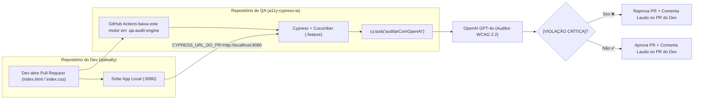

# 🤖 Motor de Quality Gate de Acessibilidade (`a11y-cypress-ia`) — Repositório de QA

Este repositório é o **Motor Central de Auditoria Dinâmica de Acessibilidade (Shift-Left Quality Gate)** mantido pela equipe de **Engenharia de Qualidade (QA)**.

Em uma arquitetura corporativa de **mundo real**, o código de automação de testes e as regras de auditoria **NÃO ficam misturados no repositório de Front-end dos desenvolvedores**.

- 📦 **Repositório do Sistema (Front-end / Dev):** [`AngeloFDiasGTech/qafeally`](https://github.com/AngeloFDiasGTech/qafeally) *(contém apenas `index.html`, `index.css` e a esteira de CI/CD)*.
- 🛡️ **Repositório do Motor de Auditoria (QA):** [`AngeloFDiasGTech/a11y-cypress-ia`](https://github.com/AngeloFDiasGTech/a11y-cypress-ia) *(este repositório — contém o Cypress, Cucumber BDD e a integração com a OpenAI GPT-4o)*.

---

## 🏗️ Como os Dois Repositórios Conversam no GitHub Actions?



### Por que separar os repositórios?
1. **Governança e Segurança do Quality Gate:** O desenvolvedor não consegue alterar ou "comentar" o teste do Cypress dentro do Pull Request dele para forçar uma aprovação.
2. **Reuso:** Este mesmo motor (`a11y-cypress-ia`) pode ser plugado na pipeline de dezenas de aplicações front-end diferentes, bastando passar a variável `CYPRESS_URL_DO_PR`.
3. **Responsabilidades Claras:** O time de Dev foca no produto (`qafeally`) e o time de QA evolui os cenários BDD e a engenharia de prompt da IA aqui no `a11y-cypress-ia`.

---

## 📂 Estrutura deste Repositório

- [`cypress.config.js`](./cypress.config.js): Configura o preprocessor Cucumber e registra a task Node.js `auditarComOpenAI`, que envia o HTML e o CSS capturados em tempo de execução para o modelo **`gpt-4o`** e salva o laudo em `cypress/reports/a11y-report.md`.
- [`cypress/e2e/features/a11y.feature`](./cypress/e2e/features/a11y.feature): Especificação em BDD (Gherkin) do Quality Gate de Acessibilidade WCAG 2.2.
- [`cypress/e2e/steps/a11ySteps.js`](./cypress/e2e/steps/a11ySteps.js): Passos que visitam `Cypress.env("URL_DO_PR") || "http://localhost:8080"`, validam os marcos estruturais (`lang="pt-BR"`, Skip Link, `<main>`, `<h1>`, `aria-live`) e acionam a auditoria da IA.

---

## 💻 Como Rodar Localmente Contra Qualquer Aplicação

1. Instale as dependências:
   ```bash
   npm install
   ```

2. Configure sua chave da OpenAI e a URL do sistema que deseja auditar:
   ```powershell
   $env:OPENAI_API_KEY="sk-sua-chave-aqui"
   $env:CYPRESS_URL_DO_PR="http://localhost:8080"
   ```

3. Execute em modo Headless ou Interativo:
   ```bash
   npm run test:headless
   # ou
   npm run test:ui
   ```
